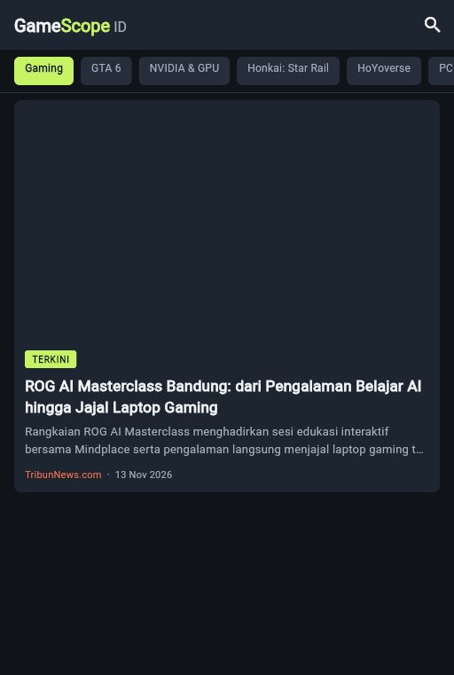
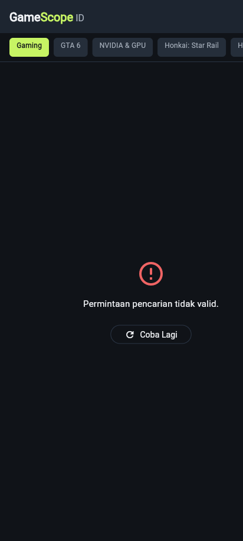
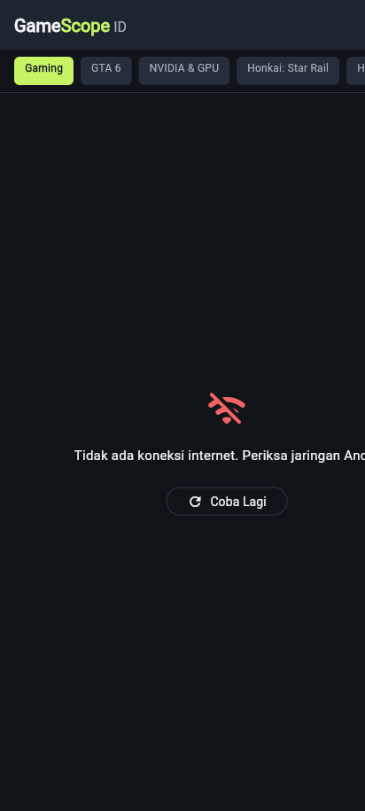

# GameScope ID

**Gaming. Technology. What's Next.**

Aplikasi berita gaming dan teknologi berbasis Flutter menggunakan GNews API. Dibuat untuk Praktikum Pemrograman Mobile Topik 11.

---

## Fitur

- 5 Kategori berita utama: Technology, Science, Entertainment (termasuk gaming), Sports, Business (GNews `/top-headlines`)
- Featured article (berita utama dengan batas tinggi 220px) + daftar berita ringkas di setiap kategori
- Menampilkan hingga 10 artikel per kategori secara langsung dari GNews API asli
- Pencarian berita melalui dialog dari AppBar
- Halaman pencarian terpisah (SearchView) dengan FutureBuilder
- Halaman detail berita dengan tombol "Baca Berita Asli"
- Pull-to-refresh di HomeView dan SearchView
- Cache Future per kategori (tidak request ulang jika sudah dimuat)
- Empat state FutureBuilder: loading, error, empty, data
- Error handling dengan pesan spesifik per kondisi
- API key aman melalui `--dart-define-from-file`

---

## Teknologi

| Paket | Versi | Kegunaan |
|---|---|---|
| `dio` | ^5.7.0 | HTTP client |
| `get` | ^4.6.6 | Navigasi |
| `cached_network_image` | ^3.4.1 | Gambar berita |
| `intl` | ^0.19.0 | Format tanggal Indonesia |
| `url_launcher` | ^6.3.1 | Buka berita asli di browser |

---

## Struktur Folder

```
lib/
  main.dart               # Entry point, theme, GetMaterialApp
  config/
    env.dart              # Konfigurasi env dari dart-define
  models/
    article_model.dart    # Model artikel
    news_response_model.dart  # Model respons API
  services/
    news_api_service.dart # Dio HTTP service
    api_exception.dart    # Exception dan pesan error terpusat
  views/
    home_view.dart        # Halaman utama dengan kategori
    search_view.dart      # Halaman hasil pencarian
    detail_view.dart      # Halaman detail artikel
  widgets/
    article_card.dart     # Card artikel (featured & list)
    error_view.dart       # Tampilan error dengan retry
    news_image.dart       # Gambar berita dengan fallback
    empty_state.dart      # Tampilan kosong
  routes/
    app_routes.dart       # Nama route
    app_pages.dart        # Daftar halaman GetX
  utils/
    app_colors.dart       # Token warna design system
    date_formatter.dart   # Format tanggal bahasa Indonesia

config/
  env.example.json        # Contoh konfigurasi (aman untuk git)
  env.json                # API key ASLI (masuk .gitignore)

docs/
  screenshots/            # Screenshot error untuk pengumpulan
    README.md             # Panduan pengambilan screenshot
    error-invalid-api-key.png   (diisi manual)
    error-no-internet.png       (diisi manual)

DESIGN.md                 # Dokumentasi desain visual
```

---

## Instalasi

### Prasyarat

- Flutter SDK 3.5+
- Chrome (untuk Flutter Web)
- Akun GNews (https://gnews.io)

### Langkah

```bash
git clone <url-repo>
cd nusa_news
flutter pub get
```

---

## Mendapatkan API Key GNews

1. Buka https://gnews.io
2. Klik **Get API Key** dan daftar akun gratis
3. Verifikasi email (wajib untuk mengaktifkan API key)
4. Salin API key dari dashboard

**Catatan Free Plan:**
- 100 request per hari
- Maksimal 10 artikel per request
- Berita mungkin tidak real-time (ada delay)

---

## Membuat config/env.json

Salin dari contoh lalu isi API key:

```bash
cp config/env.example.json config/env.json
```

Isi `config/env.json`:

```json
{
  "GNEWS_BASE_URL": "https://gnews.io/api/v4",
  "GNEWS_API_KEY": "API_KEY_ANDA_DISINI"
}
```

**JANGAN** unggah `env.json` ke GitHub. File ini sudah masuk `.gitignore`.

---

## Menjalankan Aplikasi

```bash
flutter run -d chrome --dart-define-from-file=config/env.json
```

Untuk Android:

```bash
flutter run -d android --dart-define-from-file=config/env.json
```

---

## Pengujian

### Uji API dan Kategori

1. Jalankan aplikasi
2. Pastikan berita muncul di kategori pertama (Technology)
3. Pindah ke kategori lain (Science, Entertainment, Sports, Business)
4. Verifikasi berita berubah sesuai kategori
5. Kembali ke kategori sebelumnya, pastikan tidak reload (cache aktif)

### Uji Pencarian

1. Ketuk ikon pencarian di AppBar
2. Masukkan kata kunci, contoh: `NVIDIA RTX 50 Series`
3. Ketuk Cari
4. Verifikasi SearchView tampil dengan hasil

### Uji Pull-to-Refresh

1. Tarik daftar berita ke bawah di HomeView
2. Verifikasi indikator loading muncul dan data diperbarui

### Uji Detail

1. Ketuk salah satu artikel
2. Verifikasi judul, sumber, tanggal, deskripsi tampil
3. Ketuk "Baca Berita Asli" dan verifikasi browser terbuka

---

## Mengambil Dua Screenshot Error

Lihat panduan lengkap di [docs/screenshots/README.md](docs/screenshots/README.md).

**Ringkasan:**

**Skenario 1 (API Key salah):**
```bash
# Ganti sementara di config/env.json:
# "GNEWS_API_KEY": "INVALID_KEY_12345"
flutter run -d chrome --dart-define-from-file=config/env.json
# Screenshot pesan "API Key tidak valid..."
# Kembalikan API key asli setelah selesai
```

**Skenario 2 (Offline):**
```bash
flutter run -d chrome --dart-define-from-file=config/env.json
# Buka DevTools > Network > Offline
# Screenshot pesan "Tidak ada koneksi internet..."
```

---

## Catatan Keamanan API Key

> **PENTING:** API key yang tertanam dalam build Flutter Web dapat dilihat melalui file JavaScript hasil build atau Chrome DevTools > Network tab. Konfigurasi ini hanya untuk pengembangan lokal. Jangan publikasikan build web dengan API key tertanam di dalamnya.

Untuk produksi: gunakan proxy server (misalnya Cloudflare Worker) yang menyimpan API key di sisi server.

---

## Screenshot Aplikasi

| Beranda (Live GNews) | Halaman Detail Berita | Error HTTP 401 | Error Offline / No Internet |
| :---: | :---: | :---: | :---: |
|  |  |  |  |

---

## Dibuat Oleh

Praktikum Pemrograman Mobile Topik 11 - GameScope ID
